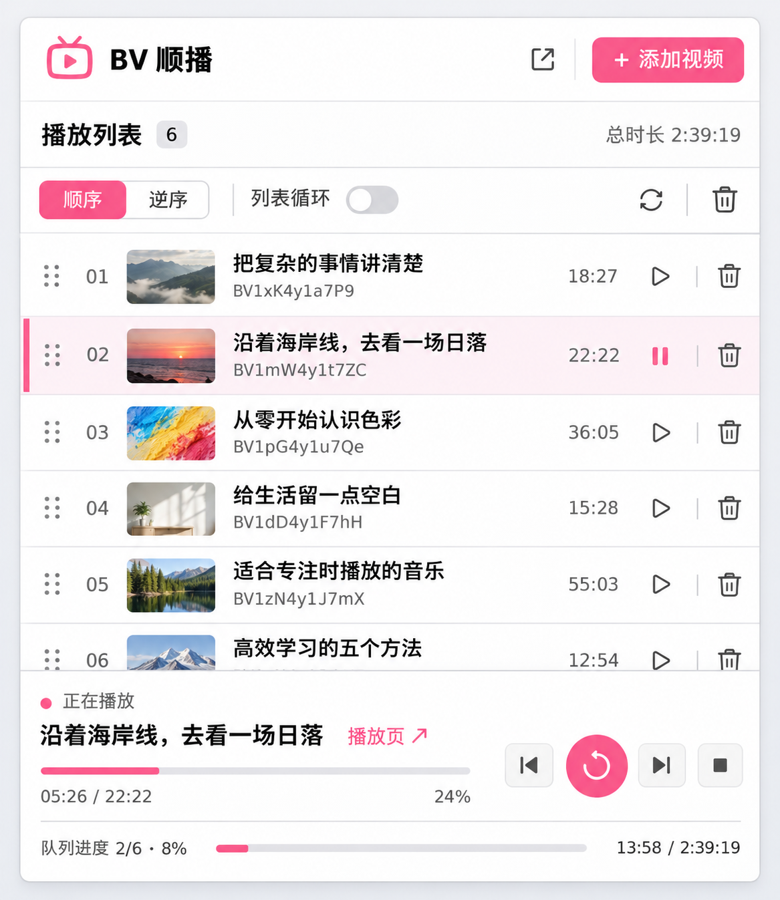

# 设计依据与实现对照

日期：2026-11-03。目标：把原先由播放卡片和帮助信息占据的界面，改成实用的紧凑视频队列。设计图先行，再按图实现和截图检查。

## 查看的原始资料

| 项目 | 查看内容 | 采用的思路 |
| --- | --- | --- |
| [Raindrop 扩展介绍](https://help.raindrop.io/install-extension)、[官方源码配置](https://github.com/raindropio/app/blob/master/package.json) | 官方扩展展示；公开源码中包含 React、Webpack 和拖动排序依赖。源码配置不等于线上部署版本。 | 列表优先，操作靠近条目，管理多个条目时避免占空间的说明卡片。 |
| [Dark Reader 控件说明](https://darkreader.org/help/en/)、[popup 源码](https://github.com/darkreader/darkreader/blob/main/src/ui/popup/index.tsx) | 紧凑控件分组；其 popup 使用 Malevic，而非 React。 | 相近设置放在一行，状态与操作明确分组。 |
| [WXT 前端集成](https://wxt.dev/guide/essentials/frontend-frameworks.html) | WXT 可集成 React、Vue 等框架，提供扩展构建入口。 | 评估过工具链；本项目已有可用 MV3 后台，因此保留后台组织，只重建界面。 |
| [React createRoot](https://react.dev/reference/react-dom/client/createRoot)、[esbuild JSX](https://esbuild.github.io/api/#jsx) | 组件渲染和生产构建。 | 使用 React 状态和带稳定 key 的队列行，避免进度刷新时替换拖动节点。 |

这些是布局与工程参考，没有复制上述项目的界面代码、图标或品牌资产。

## 生成的设计示例

使用内置 imagegen 的 ui-mockup 模式生成。最终原始提示词完整保存在 `prompt.txt`，没有使用 CLI 或 API Key。

图中缩略图、标题、BV 和时长仅用于设计展示，不构成真实播放列表。示例中的暂停样式没有作为新功能承诺：实现仍使用已验证的播放／重播当前、停止和前后切换行为，按钮都有准确的操作提示。

## 从示例到实际代码

| 设计要求 | 实现 |
| --- | --- |
| 列表为主体 | 600px 高的小窗中，队列可用高度 304px，实测完整显示 5 条。 |
| 明确的设置区 | 顺序、逆序分段按钮；循环开关；刷新、清空按钮同一行。 |
| 可识别的视频行 | 真实封面、标题、BV 和分 P；时长固定列对齐。标题过长省略，悬停可查看完整标题。 |
| 当前行低干扰标记 | 浅粉底和 3px 左侧指示线。 |
| 底部播放器 | 当前标题、状态、视频时间和百分比；队列进度与累计位置时间；控件一直可见。 |
| 排序 | 六点手柄原生拖动；更多菜单保留上移／下移。 |
| 小窗和管理页一致 | 相同结构按宽度放大，不再设置帮助信息侧栏。 |

实际截图使用公开视频数据和真实加载的 B 站封面，视频时间为受控预览状态。预览数据不写入安装包的默认列表。

## 技术实现

- React 19.3.1、React DOM 19.3.1，用于组件和状态管理。
- esbuild 0.28.2，将 JSX 和 React 编译为本地生产包，目标 Chrome 112。
- 原生 CSS 负责布局、状态和窄屏适配；原生 HTML5 拖放负责排序。
- Native dialog 负责添加窗口。导入与播放操作的并发隔离、草稿归属校验和既有错误处理保留。
- React 包随扩展分发，不从 CDN 加载脚本。没有因为换框架增加权限。
- 封面 URL 仅接受 B 站 hdslb.com 图片域名，升级 HTTPS；加载失败使用无图占位。

普通用户加载安装包即可；需要改代码时，编辑 `src/popup.jsx` 后执行 `npm run build`。生产包的第三方许可证在 `popup.js.LEGAL.txt`。
